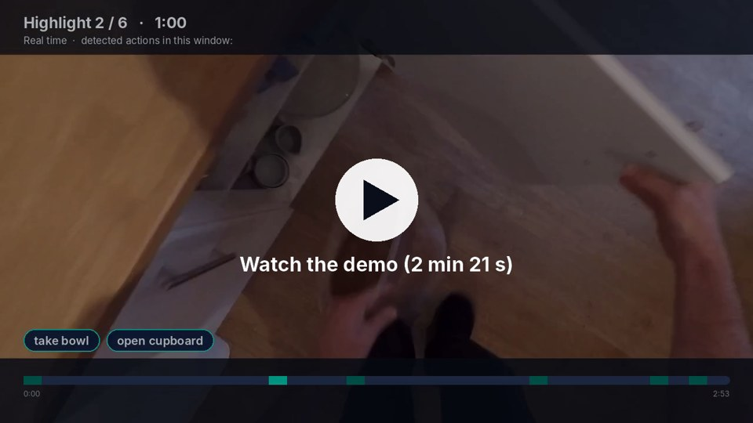

# K99 — Track 04: Action-Aware Video Summarization

### Samsung PRISM XR Hackathon 2026

This project summarizes first-person (egocentric) video. For each input video it produces the video category, a
list of detected actions (verb–noun pairs such as *open cupboard* or *pour milk*), and a set of highlight segments
that together cover at most 15 % of the video.

Highlights are chosen to contain as many **distinct actions** as possible. In kitchen video the same few actions
(take, put, wash) repeat throughout, so keeping the moments that score highest on importance tends to return several
clips of the same action. Our selector adds a segment only when it contains an action that is not already covered.

[](https://drive.google.com/file/d/1maJ7WHNem8pBXcALZBvJ4lPLA9n-loE_/view?usp=sharing)

**Demo video (2 min 21 s):** [Google Drive](https://drive.google.com/file/d/1maJ7WHNem8pBXcALZBvJ4lPLA9n-loE_/view?usp=sharing)
· **Slides:** [`VITV_K99.pptx`](VITV_K99.pptx)
· **AI use:** [`AI_DISCLOSURE.md`](AI_DISCLOSURE.md)

*The video was recorded before we removed the FPVSum-tuned settings (see below), so its results card shows the tuned
numbers. The submitted outputs are the untuned ones in the tables below.*

## Results at a glance

Measured with our own implementation of the four Track 04 metrics (the official scorer is not public).

| Metric | Result | Videos |
|---|---|---|
| Action coverage | **0.389** | 138 EPIC-KITCHENS |
| Action mAP (tIoU 0.1–0.5) | **23.0** | 138 EPIC-KITCHENS |
| Highlight F1 | **0.275** | 45 FPVSum videos with annotations |
| Label accuracy | **40 / 46** | FPVSum videos available |

The organisers advised treating the FPVSum annotations as hidden test labels, so the submitted outputs use **no
setting chosen with FPVSum labels**. For reference, our earlier version tuned on FPVSum scored 0.295 F1 and 46 / 46
labels; it is not what we submit.

Selecting highlights for distinct actions roughly **doubles coverage** compared with keeping the most
important-looking moments (**0.364 vs 0.174**, same detections, 36 held-out videos). Details are in [Results](#results).

> [!IMPORTANT]
> **`outputs/` has 184 of the 187 videos.** Three FPVSum videos are gone from YouTube, so we couldn't download them
> (checked again on 16 Nov 2026):
>
> | Video | What YouTube says |
> |---|---|
> | `Scuba__JnCVbCL5Wg` | "Private video" |
> | `Scuba_KD74Ywuy9ng` | "Private video" |
> | `Scuba_Um4kqB8bQBg` | "This video is not available" |
>
> We didn't make up placeholder files for them. If the videos come back, `./run.sh <video.mp4> outputs/<video_id>.json`
> handles them like any other video. All 138 EPIC-KITCHENS videos and the other 46 FPVSum videos are included.

---

## A quick example

`P01_12` is a 3-minute video of someone making breakfast. The system picks six 4-second clips (26 s in total):

| Clip | Starts at | What it detected there |
|---|---|---|
| 1 | 0:00 | turn on light |
| 2 | 1:00 | take bowl, open cupboard |
| 3 | 1:20 | take glass, take plate |
| 4 | 2:04 | take milk |
| 5 | 2:34 | open bag |
| 6 | 2:44 | pour cereal |

Each clip adds something new, and together they tell the whole story. The demo video shows this one playing.

## How it works

```
 video.mp4
    |
    +--> look at a few frames (CLIP) --> is this cooking, or one of 14 sports?
                                                   |
                 +---------------------------------+---------------------------------+
                 | cooking                                                           | sport
                 v                                                                   v
   find every action in the video                                     score every second for "how
   (AdaTAD: one model for verbs, one for nouns)                       highlight-worthy is this?"
                 |                                                    (CLIP prompts + motion + sound
                 v                                                     + how new the scene looks)
   join verbs and nouns into actions                                                 |
   (open + cupboard), keep the best 2000                                             v
                 |                                                    pick the best 4-second+ windows
                 v                                                    until 15 % of the video is used
   pick 4-second windows that add the most                                           |
   NEW actions, until 15 % of the video is used                                      |
                 +---------------------------------+---------------------------------+
                                                   v
                                           <video_id>.json
```

A few details that matter:

- **The action detector** is AdaTAD (from the OpenTAD toolbox), run straight from the video pixels. The original
  code needs a big GPU, so we rewrote the inference to process the video in small chunks. It now fits in about
  2.8 GB of GPU memory, and we checked that it gives the same numbers as the original.
- **Joining verbs and nouns:** some combinations never happen (*peel tap*), so we weight each pair by how often it
  shows up in the EPIC-KITCHENS *training* data.
- **Picking highlights** is a classic "cover as much as you can on a budget" problem. We solve it greedily: keep
  adding the 4-second window that brings the most not-yet-covered actions, until 15 % of the video is used.
- **Sports videos** have no action labels, so there we score each second with CLIP text prompts (like
  "landing a skateboard trick"), motion, audio loudness and how different the scene looks from the last few
  seconds. Then we pack the best windows into the same 15 % budget.

## Running it

Tested on Ubuntu 24.04 (WSL2), Python 3.10, torch 2.7.1 + CUDA 12.6, with an RTX 3050 laptop GPU (4 GB).
Exact package versions are in `requirements-lock.txt`.

```bash
git clone https://github.com/karthikeya-p/coverage-aware-video-summarization.git
cd coverage-aware-video-summarization
conda create -n t4 python=3.10 -y && conda activate t4
pip install torch==2.7.1 torchvision==0.22.1 --index-url https://download.pytorch.org/whl/cu126
sudo apt-get install -y ffmpeg build-essential
bash setup.sh                       # installs the Python packages and builds one small C++ extension
bash weights/download_weights.sh    # model weights, ~3.4 GB, checked with SHA-256
```

Then, for any video:

```bash
./run.sh /path/to/video.mp4 outputs/<video_id>.json
```

Or with Docker (needs the NVIDIA Container Toolkit):

```bash
docker build -t track04 .
docker run --gpus all -v /path/to/videos:/data track04 /data/P01_11.MP4 /data/P01_11.json
```

To check the output format (the same checks as section 4 of `TEAM_README.md`):

```bash
python code/validate.py --dir outputs/            # whole folder
python code/validate.py --file outputs/P01_12.json -v
```

Once the weights are downloaded, nothing needs the internet. On the laptop GPU above, a cooking video takes about
1/4 to 1/2 of its own length to process, and a sports video about 1/10.

Optional settings: `TEAM_ID` (written into each JSON, default `K99`), `DEVICE` (`cuda` or `cpu`),
`ADATAD_BATCH` (default 8, lower it if you run out of GPU memory), `FEAT_CACHE` (folder to cache detections).

## What's in this repo

```text
├── run.sh              # ./run.sh <video.mp4> <out.json>
├── code/               # everything run.sh uses (plus the third-party code it needs, in code/third_party/)
├── weights/            # small files; the big checkpoints come from weights/download_weights.sh
├── outputs/            # our JSON for every video we could get
├── VITV_K99.pptx       # presentation slides
├── dev/                # scripts we used for testing and scoring; run.sh never touches these
├── setup.sh, Dockerfile, requirements.txt, requirements-lock.txt
└── AI_DISCLOSURE.md
```

| File in `code/` | What it does |
|---|---|
| `run_video.py` | One video in, one JSON out (called by `run.sh`) |
| `clip_utils.py` | CLIP model and the cooking-or-which-sport decision |
| `adatad_infer.py`, `ot_loader.py` | The action detector, with our low-memory changes |
| `actionformer_infer.py` | Joins verbs and nouns into actions |
| `coverage_selector.py` | Picks the highlight windows |
| `highlightness.py` | The per-second highlight score for sports videos |
| `batch_manifest.py` | Runs every video in the manifest (can resume if stopped) |
| `validate.py` | Checks the JSON format, written from section 4 of `TEAM_README.md` (the organisers' own `validate.py` was not in the starter kit we received) |

## Results

The organisers' scoring code isn't public, so these come from our own version of the four metrics
(`dev/eval_local.py`). For coverage, we count an action as captured if at least half of it is inside a highlight.

| Metric | Our result | Videos |
|---|---|---|
| Action coverage | **0.389** | 138 EPIC-KITCHENS |
| Action mAP (tIoU 0.1–0.5) | **23.0** | 138 EPIC-KITCHENS |
| Highlight F1 | **0.275** | 45 FPVSum videos that have annotations |
| Label accuracy | **40 / 46** | FPVSum videos we could download |

**Submitted vs. tuned on FPVSum.** Both rows use the same code; only the settings differ.

| Version | Highlight F1 (two halves) | Label accuracy |
|---|---|---|
| **Submitted: no FPVSum labels used** (equal signal weights, 1 s smoothing, no added label descriptions) | **0.275** (0.291 / 0.258) | **40 / 46** |
| Reference only: weights and label descriptions tuned on FPVSum | 0.295 (0.304 / 0.285) | 46 / 46 |

The six labelling mistakes in the submitted version: two bike videos (called motor and bikepolo), one jumping
video (ski) and three plane videos (jumping, horse, jumping). In FPVSum, "plane" means a camera on a model
aircraft, which a generic description doesn't capture.

On average the highlights use 15.2 % of each video. (Videos shorter than 27 s need at least one 4-second clip,
which is more than 15 %.)

**Does the "cover new actions" idea actually help?** Yes, by about 2×. Same detections, only the way of picking
highlights changes (36 videos we didn't tune on):

| How highlights are picked | Coverage |
|---|---|
| Evenly spaced 4-second clips | 0.169 |
| Keep the most important-looking moments | 0.174 |
| **Cover as many new actions as possible (ours)** | **0.364** |

The lead holds whichever way you define "captured" (any overlap, the middle inside, half inside, fully inside).

**Which action detector?** We started with SlowFast + ActionFormer and switched to AdaTAD:

| Detector | Verb mAP | Noun mAP | Action mAP | Coverage |
|---|---|---|---|---|
| SlowFast + ActionFormer | 23.2 | 20.7 | 15.9 | 0.377 |
| **AdaTAD** | **28.9** | **29.8** | **23.0** | **0.389** |

For context, AdaTAD's authors report 29.7 / 29.4 for verbs / nouns, so our low-memory version matches. Getting
both the verb *and* the noun right is hard for everyone on this dataset: recent challenge entries are around
23–30 action mAP, and the top ones use much bigger models.

**What holds coverage back?** If we feed the selector the true actions instead of our detections, coverage goes
from 0.39 to 0.57. Only about a quarter of the detector's most confident guesses get both verb and noun right,
so the selector sometimes thinks a mislabelled repeat is a new action. A better detector would help more than a
better selector.

## Things we tried that didn't help

We only kept a change if it helped on both halves of the data. These didn't:

| Idea | What happened |
|---|---|
| A smarter selector that guesses which actions are real | Coverage 0.36 (worse) |
| Removing duplicate detections, density-based picking, different cut-offs | No consistent gain |
| Combining the two detectors | At most +0.4 mAP, basically noise |
| Bigger CLIP models for the cooking/sport decision | No gain (tested on the tuned version, already 46/46) |
| A highlight scorer trained on TVSum and used on FPVSum | F1 0.18–0.24 (worse than ours) |
| Asking a 7B vision-language model (Qwen2.5-VL) to rate every 4-second clip | F1 0.22–0.25 alone, 0.282 at best when mixed with our tuned curve (tuned curve alone: 0.295) |
| Same model, but first describing every clip and the whole video, then rating each clip in context | Worse: F1 0.18–0.19 alone. It sometimes described the video wrong (bike polo as skateboarding) |

So our small zero-shot scorer actually beats a 7B model here. The notebooks for the last two are in
`dev/kaggle/`, and the scoring script is `dev/fpv_fusion_eval.py`.

## Being upfront about tuning

We didn't train any model; everything uses public checkpoints. A few settings were chosen while looking at
public annotations, and we want to be clear about which:

- **AdaTAD weights** were trained by the OpenTAD authors on EPIC-KITCHENS-100. We couldn't confirm whether the
  backbone's EPIC fine-tuning used only the training split.
- **The selector's score cut-off (0.25)** was picked with a two-way split of the 138 EPIC validation videos. Every
  value from 0.2 to 0.3 gave 0.38–0.39 on each half. (An earlier pick based on just 30 videos didn't hold up on
  the other 108, so we switched.)
- **Other pairing and selector settings** were picked on a fixed set of 30 videos (`dev/tune_ids.txt`).
- **FPVSum: nothing tuned in the submitted version.** During development we had picked the sports highlight
  weights (four signal weights and one smoothing value) using the FPVSum annotations, and added six label
  descriptions (for bike, jumping and plane) after looking at which FPVSum videos were mislabelled. After the
  organisers advised treating the FPVSum annotations as hidden test labels, we removed both: the submitted
  version uses equal weights, 1-second smoothing, and drops the six added descriptions. The exact wording before
  our edits wasn't kept, so removing the added lines is the closest we can get to the original. The tuned
  numbers are shown above for reference only.
- The verb–noun weights use only the EPIC-KITCHENS *training* split.

At run time nothing reads any annotation, no video ID appears in the code, and the cooking/sport decision comes
from the pixels alone (the system itself routes all 138 EPIC videos to "cooking").

## Limitations

- Three Scuba videos are missing (see the note at the top).
- Coverage is limited by how often the detector gets both verb and noun right, not by the selector.
- The sports highlight score is zero-shot and still far from the best possible.
- AdaTAD is heavy: two 0.3-billion-parameter models run over every cooking video.

## Why this is useful for XR

Smart glasses record a lot of video. Keeping only 15 % of it, chosen to hold as many different hand–object
actions as possible, means an on-device assistant has about 6.7× fewer frames to look at, while still seeing
about twice as many different actions as an importance-based summary of the same length.

## Credits

AdaTAD and the OpenTAD toolbox; ActionFormer (Zhang, Wu, Li, ECCV 2022); VideoMAE; EPIC-KITCHENS-100 and its
SlowFast baseline (Damen et al.); OpenCLIP; FPVSum (Ho, Chiu, Wang, ECCV 2018); TVSum (Song et al., CVPR 2015,
only in a failed experiment); Qwen2.5-VL-7B-Instruct (only in the two failed experiments, not in `run.sh`).
How we used AI tools while building this is described in [`AI_DISCLOSURE.md`](AI_DISCLOSURE.md).
